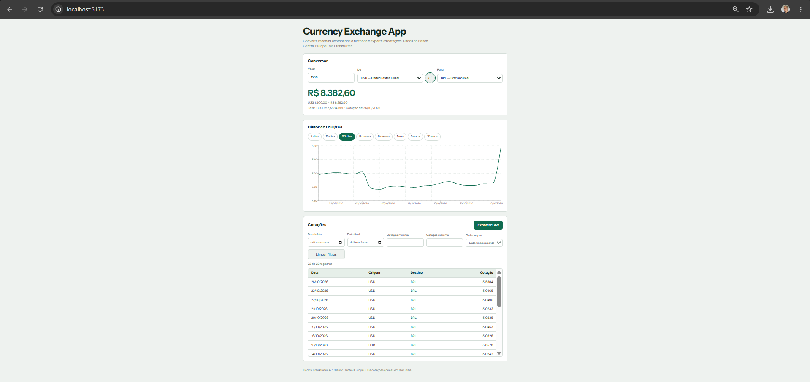
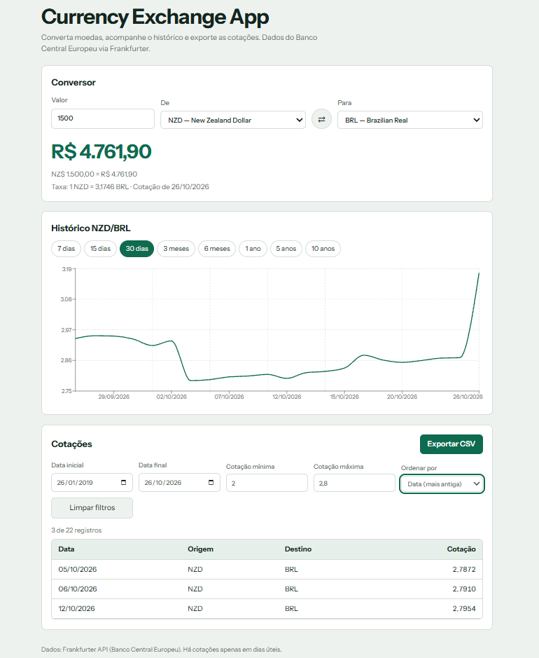
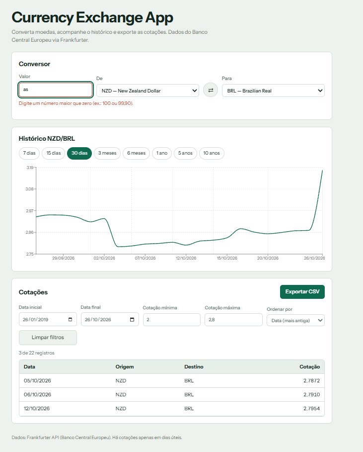
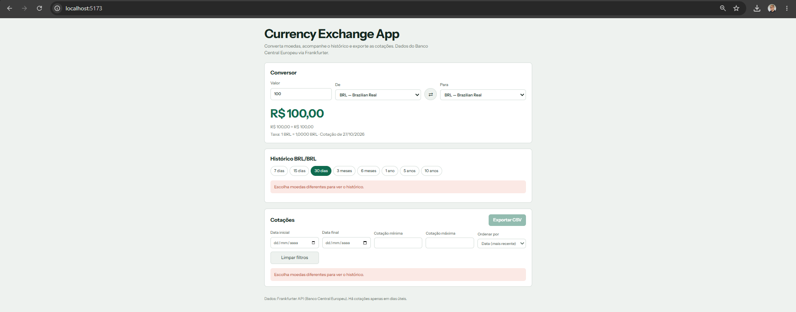
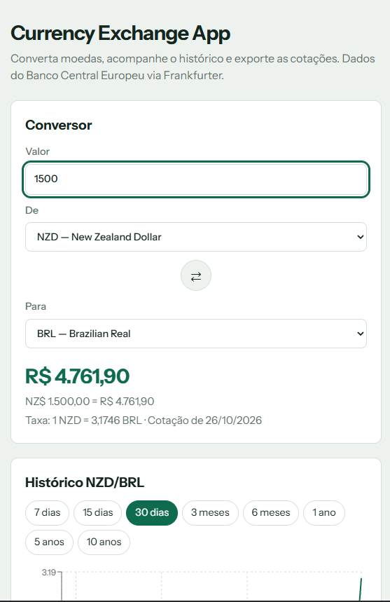
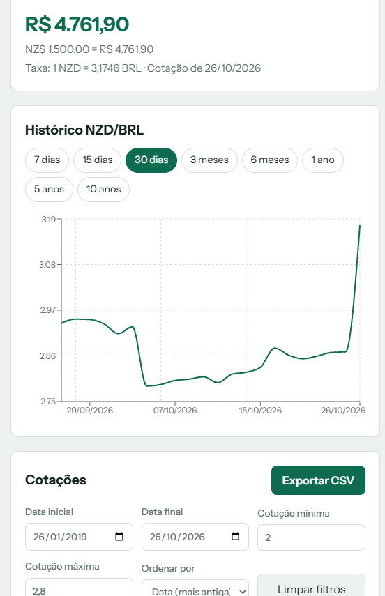
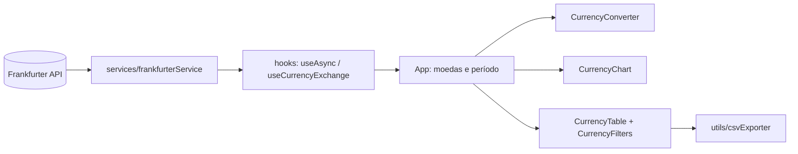

<div align="center">

# 💱 Currency Exchange App

**Converta moedas, acompanhe o histórico de cotações e exporte os dados em CSV.**




</div>

---

## ✨ Sobre o projeto
SPA desenvolvida em React como **Projeto 01** do curso. Ela centraliza em uma única tela o que antes exigia vários sites e planilhas: consultar a taxa de câmbio, converter valores, analisar a evolução de um par de moedas e levar os dados filtrados para o Excel. Os dados vêm da [Frankfurter API](https://frankfurter.dev) (taxas de referência do Banco Central Europeu), sem necessidade de chave de acesso.

## 🚀 Funcionalidades
| Módulo | O que faz |
|---|---|
| 💱 **Conversor** | Escolha de moedas (carregadas da API), valor com validação, resultado instantâneo, taxa usada, data da cotação e botão para inverter as moedas |
| 📈 **Histórico** | Gráfico responsivo para 7 dias, 15 dias, 30 dias, 3 meses, 6 meses, 1 ano, 5 anos e 10 anos; atualiza ao mudar o par ou o período |
| 🔎 **Tabela e filtros** | Data, origem, destino e cotação; filtros combináveis por intervalo de datas e cotação mínima/máxima; ordenação por data e cotação; contador de registros |
| 📥 **Exportação CSV** | Exporta somente os registros filtrados, com cabeçalho, nome de arquivo identificável e bloqueio de exportação vazia |
| 🛡️ **Robustez** | Estados de carregando, erro de API, sem dados e entrada inválida; requisições antigas são canceladas |

## 🖼️ Telas
**Filtros combinados e ordenação** (NZD → BRL): datas, cotação mínima 2 e máxima 2,8, ordem "mais antiga"; 3 de 22 registros.



| Validação de entrada | Moedas iguais |
|---|---|
|  |  |

**Versão mobile** (layout em coluna única)

| Conversor | Gráfico e filtros |
|---|---|
|  |  |

Exemplo de arquivo gerado: [`cotacoes_BRL-EUR_2026-09-29_a_2026-10-26.csv`](docs/evidencias/cotacoes_BRL-EUR_2026-09-29_a_2026-10-26.csv)

## 🛠️ Tecnologias
| Camada | Tecnologia |
|---|---|
| Interface | React 18 + JSX (componentes funcionais) |
| Build/dev | Vite 5 |
| Estilos | CSS Modules (escopo isolado por componente) |
| Estado e efeitos | `useState`, `useEffect`, hooks customizados, *lifting state up* |
| Dados | Fetch API com `async/await` e `AbortController` |
| Gráficos | Recharts |
| Testes | Node (funções puras e serviço com `fetch` simulado) e Postman (API) |

## ⚙️ Como executar
Pré-requisito: [Node.js](https://nodejs.org) 18 ou superior.

```bash
git clone https://github.com/Fesiqqq/CambioAPP.git
cd CambioAPP
npm install
npm run dev      # abre em http://localhost:5173
```

Outros comandos:
```bash
npm run build    # build de produção
npm run preview  # visualizar o build
npm test         # 23 testes automatizados (serviço + funções)
```

<details>
<summary>Erro "Controle de Aplicativo bloqueou este arquivo" no Windows</summary>

O `package.json` já usa o Rollup em WebAssembly (`overrides`), que não depende do binário nativo bloqueado por algumas políticas do Windows. Se mesmo assim ocorrer o erro, apague `node_modules` e `package-lock.json` e rode `npm install` novamente.
</details>

## 🧱 Arquitetura


```text
src/
  assets/
  components/   # Header, CurrencyConverter, CurrencyChart, PeriodSelector,
                # CurrencyTable, CurrencyFilters, StatusMessage (+ .module.css)
  hooks/        # useAsync, useCurrencyExchange (useCurrencies, useLatestRate, useHistory)
  services/     # frankfurterService.js: única camada que chama a API
  utils/        # dates, formatters, rates (normalizar/filtrar/ordenar), csvExporter
  constants/    # períodos, moedas padrão, filtros vazios
  App.jsx, App.module.css, main.jsx
```
O `App` guarda o par de moedas e o período e busca o histórico uma única vez, compartilhando os dados entre o gráfico e a tabela.

## 📏 Regras de negócio em destaque
- Valor convertido = valor informado × taxa da cotação mais recente publicada.
- Moedas iguais: taxa 1 e histórico indisponível com aviso (a API não aceita origem = destino).
- A API publica apenas dias úteis; datas sem cotação não aparecem e nada é inventado.
- Filtros inconsistentes (data inicial maior que a final, mínima maior que a máxima) exibem aviso e bloqueiam a exportação.
- Para períodos longos (5 e 10 anos) a API devolve dados agregados, então o gráfico tem menos pontos.

## 📚 Documentação
| Documento | Conteúdo |
|---|---|
| [`docs/REQUIREMENTS.md`](docs/REQUIREMENTS.md) | Contexto, requisitos, regras de negócio e critérios de aceite |
| [`docs/COMPONENTS.md`](docs/COMPONENTS.md) | Componentes, arquivos, props, estados e relações |
| [`docs/FIGMA.md`](docs/FIGMA.md) | Link do protótipo (Figma Make) e especificação visual |
| [`docs/API_TESTS.md`](docs/API_TESTS.md) | Investigação e testes da API (Postman) e evidências |
| [`docs/FUNCTION_TESTS.md`](docs/FUNCTION_TESTS.md) | Testes das funções JavaScript e checklist final |
| [`docs/AI_USAGE.md`](docs/AI_USAGE.md) | Registro do uso de IA |
| [`docs/STEPS.md`](docs/STEPS.md) | Evolução em 10 etapas, com commits e testes |
| [`docs/postman/`](docs/postman/frankfurter.postman_collection.json) | Collection do Postman exportada |

## 🌿 Versionamento
Desenvolvimento incremental com commits semânticos (`feat:`, `refactor:`, `test:`, `docs:`, `fix:`), acompanhando as aulas. Veja o histórico com `git log --oneline`.

## 👤 Autor
Projeto individual desenvolvido por **Fernando Siqueira** ([@Fesiqqq](https://github.com/Fesiqqq)). Dados cambiais: Frankfurter API / Banco Central Europeu.
